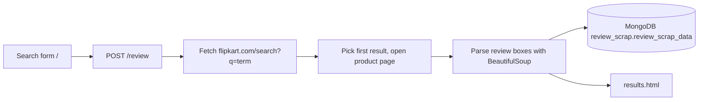

# websciper - Flipkart Review Scraper

A small Flask web app that takes a product search term, scrapes customer reviews for the first matching Flipkart product, shows them in a results page and stores them in MongoDB.

## How it works (`application.py`)

For each review it extracts customer name, rating, heading and comment. A CSV file named after the search term is also created in the working directory (header row only is written in the current code).

## Tech stack
Python, Flask, Flask-Cors, requests, urllib, BeautifulSoup4, PyMongo, Gunicorn; Jinja2 templates + CSS; GitHub Actions workflow for Azure Static Web Apps.

## Structure
```
application.py        # Flask app, routes / and /review
templates/            # base.html, index.html (search), results.html
static/css/           # main.css, style.css
requirements.txt
.github/workflows/    # Azure Static Web Apps CI file
```

## Run
```bash
pip install -r requirements.txt
python application.py     # serves on http://127.0.0.1:8000
```
The MongoDB connection string is currently hard-coded in `application.py`; replace it with your own (ideally read from an environment variable) before use.

## Limitations
- Scraping relies on Flipkart CSS class names from 2022-23 and will likely no longer match.
- Pinned old dependencies (Flask 1.1.2 etc.).
- Hard-coded database URI; no tests; Azure Static Web Apps cannot host a Flask backend, so that workflow is not a real deployment.
- Scraping may violate the target site's terms of service.
